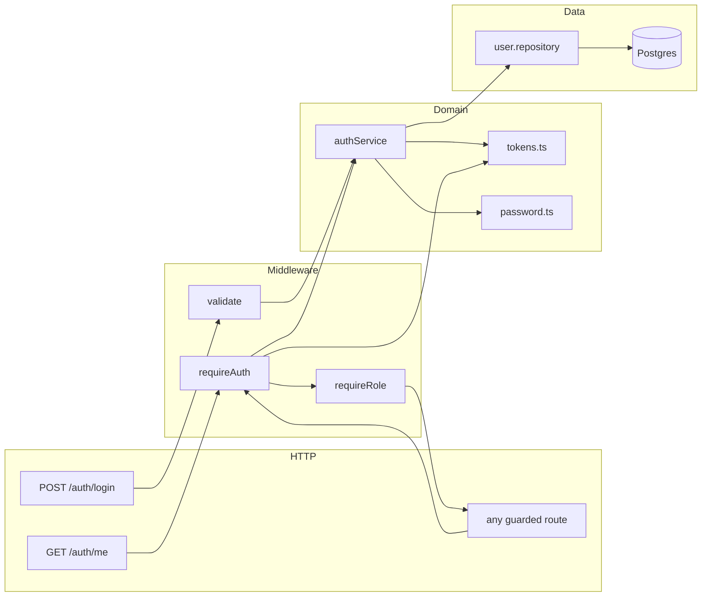
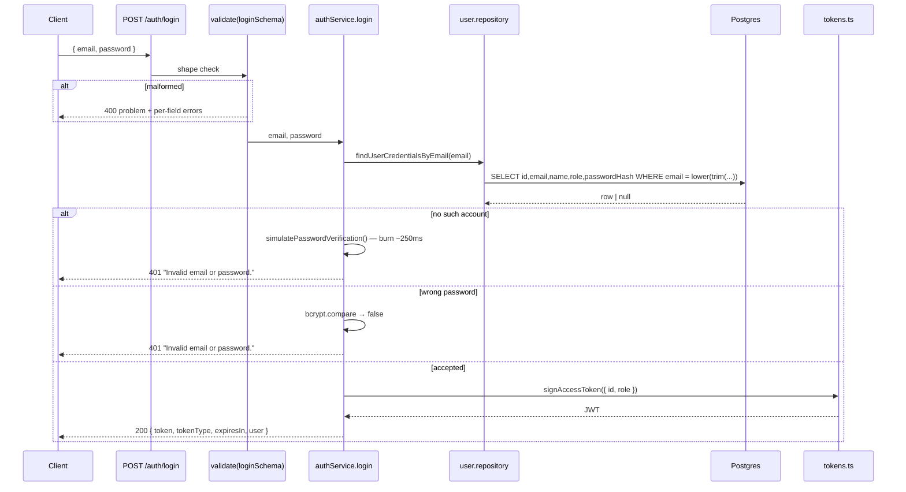
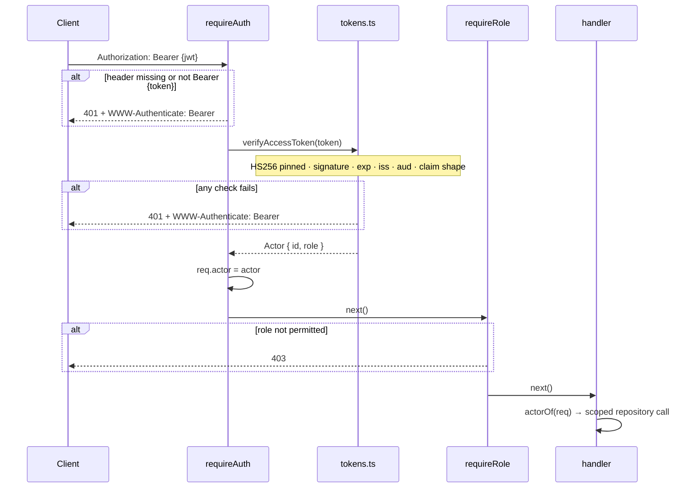

# Authentication flow

How a caller gets a token, how a request proves who it is, and where each rule is
enforced. Implemented on D3 of [PLAN.md](../PLAN.md) §11; this document is the reference
for the people extending it in D4–D10.

[PLAN.md](../PLAN.md) §4 sets the constraint everything here serves:

> All routes behind `requireAuth` (JWT bearer, seeded users, 15-min tokens). There is no
> unauthenticated route except `POST /auth/login` and `GET /health`.

---

## 1. The shape of it

Two endpoints, two middlewares, one type that travels from the HTTP boundary down to the
data-access layer.



| File | Responsibility |
|---|---|
| [src/domain/actor.ts](../src/domain/actor.ts) | `Actor` — `{ id, role }`, the only identity the layers below HTTP see |
| [src/auth/password.ts](../src/auth/password.ts) | bcrypt hash/verify, plus the dummy compare that defeats timing enumeration |
| [src/auth/tokens.ts](../src/auth/tokens.ts) | sign and verify the 15-minute HS256 token |
| [src/repositories/user.repository.ts](../src/repositories/user.repository.ts) | the two user field-sets; the only place Prisma is touched |
| [src/services/auth.service.ts](../src/services/auth.service.ts) | `login`, `describeActor` — the credential logic |
| [src/http/middleware/auth.ts](../src/http/middleware/auth.ts) | `requireAuth`, `requireRole`, `actorOf` |
| [src/http/routes/auth.ts](../src/http/routes/auth.ts) | the two routes, their zod schemas, their OpenAPI entries |
| [src/seed.ts](../src/seed.ts) | the seven development accounts |

---

## 2. Login



Three details in that diagram are the whole point of it:

**The two failure branches are indistinguishable.** Same status, same body, and — because
the "no such account" branch runs a bcrypt compare against a throwaway hash it would
otherwise skip — the same duration. Measured on the development machine: 263.5ms for a
wrong password, 261.8ms for an unknown account. Without the dummy compare the unknown path
returns in about 1ms, and two identical response bodies are separated by a stopwatch.

**Email normalisation is split deliberately.** The route schema trims surrounding
whitespace, because a pasted address routinely carries it and that is a shape concern.
Lower-casing happens in `normalizeEmail` in the repository, next to the unique index that
depends on it. Neither layer does the other's job.

**No password policy at this boundary.** `loginSchema` checks that a password is present,
not that it is long. Rejecting a short one would tell the caller their guess was too short
to be this account's password.

---

## 3. An authenticated request



Verification is **stateless** — no database round-trip per request. The token carries the
whole `Actor`, so nothing needs loading to know who is calling.

The trade is explicit: a role change or a disabled account takes effect at the next login,
up to 15 minutes later. That window is the argument for the short TTL rather than an
oversight. An endpoint that must reflect the current row reads it itself — `GET /auth/me`
does, which is why a token whose subject was deleted gets a 401 rather than an echo of its
own claims.

### The token

```jsonc
{
  "sub":  "300c2087-…",              // the user id
  "role": "RECRUITER",               // UserRole
  "iss":  "recruitment-pipeline-poc",
  "aud":  "recruitment-pipeline-poc-api",
  "iat":  1789566843,
  "exp":  1789567743                 // iat + 900
}
```

`sub` and `role` are exactly the `Actor`, and deliberately nothing else. No name, no
email: tokens get quoted in logs and bug reports, and that is not a place personal data
should leak from. A test asserts the claim set is exactly these six keys.

---

## 4. Where each rule is enforced

| Rule | Enforced in | Mechanism |
|---|---|---|
| No anonymous access to anything but login and health | [middleware/auth.ts](../src/http/middleware/auth.ts) | `requireAuth` on every router except the two |
| Role restrictions | [middleware/auth.ts:55](../src/http/middleware/auth.ts#L55) | `requireRole(...)`, mounted after `requireAuth` |
| Token cannot be forged or downgraded | [tokens.ts:52](../src/auth/tokens.ts#L52) | `algorithms: ['HS256']` pinned on verify |
| Token cannot outlive its window | [tokens.ts:9](../src/auth/tokens.ts#L9) | `expiresIn: 900`, checked by `jwt.verify` |
| A stale token's role cannot be trusted blindly | [tokens.ts:28](../src/auth/tokens.ts#L28) | zod re-validates the claims before they become an `Actor` |
| Passwords are never stored recoverably | [password.ts:9](../src/auth/password.ts#L9) | bcrypt, cost 12 |
| `passwordHash` never leaves the API | [user.repository.ts:13](../src/repositories/user.repository.ts#L13) | `USER_SELECT.public` does not name the column |
| No account enumeration | [auth.service.ts:29](../src/services/auth.service.ts#L29) | one message, one status, one duration |
| Bad input never reaches a service | [middleware/validate.ts](../src/http/middleware/validate.ts) | zod, before the handler (PLAN.md §7) |
| Handlers cannot reach Prisma directly | [eslint.config.js](../eslint.config.js) | `no-restricted-imports` on `db/client` |

### The field-set rule, applied to credentials

[PLAN.md](../PLAN.md) §1 makes field-set selection structural for candidate contact
details. `passwordHash` is the other restricted column in the schema, and it gets the same
treatment:

```ts
export const USER_SELECT = {
  public:          { id: true, email: true, name: true, role: true },
  withCredentials: { id: true, email: true, name: true, role: true, passwordHash: true },
};
```

`withCredentials` is read by one function, consumed by one service, and its result never
leaves `authService.login` — the wide shape never reaches a serializer, so it cannot leak
by accident.

### One repository function takes no actor

Every other read path in this codebase is scoped by the caller's identity. `login` cannot
be: it *is* the call that establishes who the caller is. That exemption is called out in
[user.repository.ts:40](../src/repositories/user.repository.ts#L40) so the §1 rule does not
look quietly broken to the next reader.

---

## 5. Status codes

| Code | When | Notes |
|---|---|---|
| `400` | Shape validation failed | Per-field `errors[]`; raised before any service runs |
| `401` | No/blank/malformed header, wrong scheme, bad signature, `alg: none`, expired, wrong `iss`/`aud`, unknown role claim, deleted subject | Always with `WWW-Authenticate: Bearer` |
| `403` | Authenticated, wrong role | The route's existence is not a secret |
| `404` | Out-of-scope **resource** | A 403 would confirm the record exists (PLAN.md §4). Lands with the scoped repositories in D4 |

The 403/404 split is the one that usually surprises people. The rule: **deny by role → 403,
deny by scope → 404.** An interviewer asking for `POST /roles` is told plainly they are not
a recruiter. An interviewer asking for a candidate they are not assigned to gets the same
answer as if that candidate did not exist.

Every error serialises through the single handler in
[errorHandler.ts](../src/http/middleware/errorHandler.ts), so the problem shape and the
`WWW-Authenticate` header are set in exactly one place.

---

## 6. Adding a guarded route (what D4 needs)

Order matters: `requireAuth` first, then `requireRole`, then `validate`, then the handler.

```ts
import { actorOf, requireAuth, requireRole } from '../middleware/auth.js';
import { params, validate } from '../middleware/validate.js';
import { UserRole } from '@prisma/client';

const paramsSchema = z.object({ id: z.uuid() });

candidateRouter.get(
  '/candidates/:id',
  requireAuth,
  requireRole(UserRole.RECRUITER, UserRole.INTERVIEWER),
  validate({ params: paramsSchema }),
  async (req, res) => {
    const actor = actorOf(req);                       // { id, role }
    const { id } = params<{ id: string }>(req);

    // The actor goes *into* the query — it is not an `if` after the fetch.
    const candidate = await findCandidateFor(actor, id);
    if (!candidate) throw new NotFoundError();        // 404, never 403

    res.json(candidate);
  },
);
```

Three things that are easy to get wrong:

1. **`actorOf(req)`, not `req.actor`.** It throws if the actor is missing, so a route
   mounted without `requireAuth` fails loudly at the first line instead of running a query
   with an undefined id.
2. **Pass the actor into the repository.** Per PLAN.md §1 the assignment check is a JOIN
   in the same query, not a filter afterwards. A repository that returns a candidate
   without an `actor` argument should not exist.
3. **Register the route for the docs** with `registerOperation` next to the handler, so
   the OpenAPI spec stays generated rather than written. See
   [openapi/registry.ts](../src/http/openapi/registry.ts).

`requireRole` fails closed: mounted without `requireAuth` ahead of it, it returns 401
rather than reading an undefined actor. A wiring mistake cannot open a route.

---

## 7. Accounts

`npm run db:seed` (or `SEED=true` under compose) creates seven accounts, idempotently —
it upserts, so re-running resets them to the documented values.

| Email | Role |
|---|---|
| `rachel.recruiter@example.com`, `raj.recruiter@example.com` | RECRUITER |
| `ingrid.` / `ivan.` / `iris.` / `ian.interviewer@example.com` | INTERVIEWER |
| `hana.manager@example.com`, `hamid.manager@example.com` | HIRING_MANAGER |

Password for all eight: `poc-dev-password`.

These are committed on purpose, so a reviewer can curl the API a minute after
`docker compose up`. Nothing here is a secret and nothing here should meet real data.

---

## 8. Tests

25 cases in [tests/auth.test.ts](../tests/auth.test.ts), against a real Postgres — no
mocked Prisma anywhere (PLAN.md §9). The ones worth knowing about:

| Concern | Test |
|---|---|
| Brief §6 "bad input rejected pre-logic" | 4 table-driven bodies → 400 from the middleware |
| Brief §6 "no anonymous path" | 7 table-driven bad headers → 401 |
| Credential leak | response body scanned for `passwordHash`, any `$2…` bcrypt string, and the plaintext; token claim set asserted exactly |
| Enumeration | wrong password and unknown account asserted **byte-identical** |
| Forgery | token signed with a different secret → 401 |
| Algorithm downgrade | hand-rolled `alg: none` token → 401 |
| Expiry | token signed with `expiresIn: -60` → 401 |
| Stale subject | valid signature, deleted user → 401 |
| Corrupt claims | `role: 'SUPERUSER'` → 401 |
| Role gate | wrong role → **403, not 404**; multi-role allow-list; fails closed without `requireAuth` |

The role gate has no route of its own yet, so those cases drive `requireRole` through a
purpose-built Express app assembled the same way [app.ts](../src/app.ts) assembles the
real one.

---

## 9. Deliberately not built

Each of these is a small addition if the walkthrough wants it; none is an oversight.

| Omitted | Why |
|---|---|
| Refresh tokens | Re-login is one curl against a 15-minute token |
| Logout / token denylist | The short TTL is the revocation story. A denylist would make verification stateful, which is the property that keeps `requireAuth` free of a database round-trip |
| Login rate limiting | Real gap. bcrypt at cost 12 makes online guessing expensive (~4 attempts/sec/core) but that is a side effect, not a control |
| `AuditEvent` on login | PLAN.md §8 scopes the audit trail to domain mutations. Auth events are a reasonable extension, and the `actorId` FK means failed logins for unknown emails have no actor to record |
| Password change / reset | No UI, no email — out of scope per PLAN.md §13 |
| Postgres RLS on `User` | Layer 3 in PLAN.md §1, scheduled for D12, and aimed at candidate columns rather than credentials |

---

## 10. Open questions for review

1. **Is the 15-minute stale-role window acceptable?** The alternative is a `findUserById`
   on every request — one indexed lookup, and role changes land immediately. The stateless
   choice is reversible in about ten lines of `requireAuth`.
2. **Should login write an `AuditEvent`?** "A candidate disputes how they were assessed"
   (PLAN.md §8) is about stage movement, but a reviewer may expect authentication events in
   the same timeline.
3. **Rate limiting before the walkthrough?** The honest answer today is that there is none.
